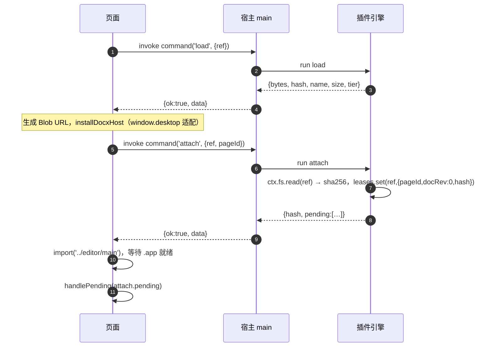
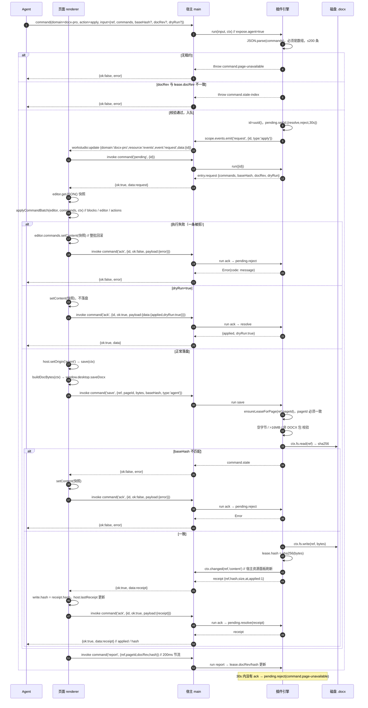
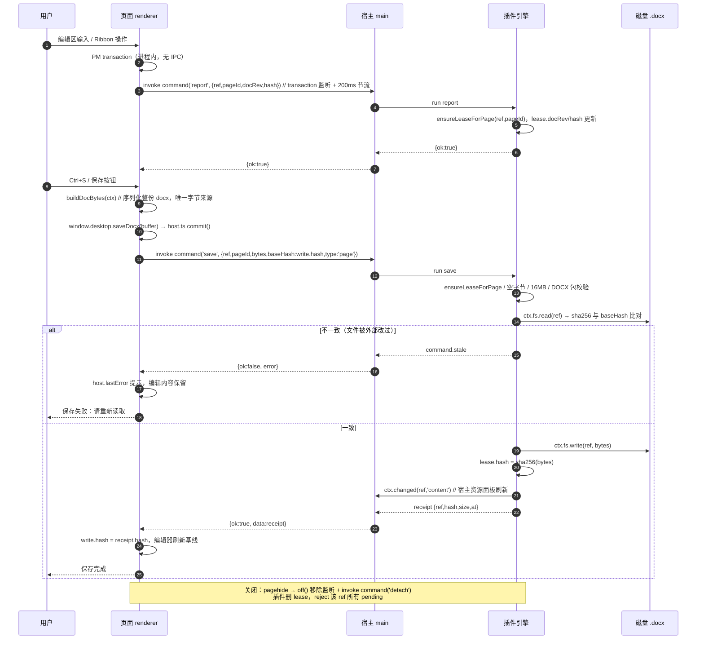

# docx-pro 通讯协议与编辑时序

> 对象：`packages/docx-pro`（v1.0.4）
> 依据：`src/engine/index.ts`、`src/page/main.ts`、`src/page/lease.ts`、`src/page/host.ts`、`commands.json`；
> 宿主侧（preload / Dispatcher / DomainRegistry）不在本仓库，按 `docs/docx-pro-runtime.md`、`docs/docx-pro-remediation.md`、`docs/docx-plus-design.md` §2 的核对结论描述。
>
> 本文只回答两件事：**谁发送、谁接收**；**Agent 编辑与人工编辑的时序**。

---

## 0. 参与方

| 角色 | 进程 | 说明 |
| --- | --- | --- |
| Agent | 外部 | 助手 / CLI，通过 `command` 工具调用插件命令 |
| 页面 renderer | 渲染进程 | `plugin://docx-pro/content?ref=…`，GenOffice Docs 编辑器 fork |
| 编辑器（PM） | 渲染进程 | 页面内实例，`window.__docxPro.getEditor()/getCtx()` 可取 |
| 宿主 main | 主进程 | preload、Dispatcher、PluginManager、TransportRouter、WorkspaceFiles、DomainRegistry |
| 插件引擎 | 主进程 | `dist/engine.js`，`definePlugin` 产物；**与宿主 main 同进程** |
| 磁盘 `.docx` | — | 唯一持久化真相 |

**关键前提：main 与插件同进程。** 两者之间的箭头是函数调用，只有页面 ↔ main 才是 IPC。

---

## 1. 箭头约定

| 箭头 | 含义 | 底层 |
| --- | --- | --- |
| `->>` 页面 → main | 请求/响应 | `ipcRenderer.invoke('workstudio:command' \| 'workstudio:subscribe')` |
| `-->>` main → 页面 | 推送 | `webContents.send('workstudio:update')` |
| `->>` main ↔ 插件 | 函数调用 / Promise | Dispatcher 直接调 `run(input, ctx)`；插件调 `scope.events.emit` |
| `->>` 插件 → 磁盘 | 文件读写 | `ctx.fs.read/write`（adapter 另用 `node:fs`） |
| 同 participant 内 | 进程内 | PM 事务、序列化、快照回滚 |

`window.workStudio` 暴露面（`src/page/env.d.ts`）：

```ts
interface WorkStudioBridge {
  readonly workspaceId: string | null
  command<T>(domain, resource, action, input?): Promise<CallResult<T>>  // invoke
  subscribe(domain, resource): Promise<unknown>                          // invoke，返回快照
  unsubscribe(domain, resource): void                                    // 本插件从未调用
  onUpdate(listener: (u: DomainUpdate) => void): () => void               // ipcRenderer.on
}
```

页面拿不到裸 `ipcRenderer`；能发什么由 `commands.json` 的 `expose.agent` 与宿主 `commandDenialOf` 决定。

---

## 2. 通道总表

| # | 方向 | 机制 | 具体通道 | 代码位置 |
| --- | --- | --- | --- | --- |
| ① | Agent → main | 工具调用（非 IPC） | `{domain:'docx-pro', action, input}` | Dispatcher |
| ② | main → 页面 | push | `workstudio:update` → `onUpdate` | `page/main.ts:32`、`page/lease.ts:178` |
| ③ | 页面 → main | invoke | `workstudio:command` | `main.ts:50,102`、`host.ts`、`lease.ts` |
| ④ | 页面 → main | invoke | `workstudio:subscribe` | `main.ts:26`、`lease.ts:59` |
| ⑤ | 页面 → main | send（单向） | `workstudio:notify` | **本插件未使用** |
| ⑥ | 页面 → main | invoke | `workstudio:file-token` | 未使用 |
| ⑦ | main → 插件 | 动态 `import` | `exports['./workstudio']` → `dist/engine.js` | `scripts/build.mjs` |
| ⑧ | 插件 ↔ 磁盘 | 函数调用 | `ctx.fs.read/write`；adapter 直接 `node:fs` | `engine/index.ts`、`engine/read.ts` |
| ⑨ | 页面 ↔ 编辑器 | 同进程 | `window.__docxPro`、`window.desktop` | `page/lease.ts`、`page/host.ts` |

---

## 3. 谁发送 → 谁接收（逐条）

### 3.1 页面 ↔ 宿主主进程

| 谁发送 | 谁接收 | 发送什么 | 通道 | 时机 |
| --- | --- | --- | --- | --- |
| 页面 | main | `command('docx-pro','docx-pro','load',{ref})` | invoke | 启动，取字节 |
| 页面 | main | `command(…,'attach',{ref,pageId})` | invoke | 启动，登记租约 |
| 页面 | main | `command(…,'pending',{id})` | invoke | 收到 `request` 事件后取正文 |
| 页面 | main | `command(…,'save',{ref,pageId,bytes,baseHash,type})` | invoke | 人工保存 / Agent 批次落盘 |
| 页面 | main | `command(…,'report',{ref,pageId,docRev,hash})` | invoke | 每次事务（节流 200ms）+ 15s 心跳 |
| 页面 | main | `command(…,'ack',{id,ok,payload})` | invoke | 处理完 Agent 请求 |
| 页面 | main | `command(…,'detach',{ref,pageId})` | invoke | `pagehide` |
| main | 页面 | 上述每条命令的返回值 `{ok,data}` / `{ok,error}` | invoke resolve | 紧接每条命令 |
| 页面 | main | `subscribe('docx-pro','events')` | invoke | 启动一次，无回调 |
| 页面 | main | `subscribe('shell','appearance')` | invoke | 启动一次，返回当前主题快照 |
| main | 页面 | `{domain:'docx-pro',resource:'events',type:'event',event:'request',data:{id,type}}` | `workstudio:update` | Agent 调 `read`/`apply` 且页面有租约 |
| main | 页面 | `{domain:'shell',resource:'appearance',type:'snapshot'\|'patch',data:{theme}}` | `workstudio:update` | 用户切主题 |

**订阅要拆成两条看**：`subscribe` 是页面 → main 的一次登记（有返回值）；`workstudio:update` 是 main → 页面的持续投递。`onUpdate` 不是发送方，它是页面里接收后者的监听器。

### 3.2 主进程内部（不走 IPC）

| 谁发送 | 谁接收 | 发送什么 | 方式 |
| --- | --- | --- | --- |
| Agent | Dispatcher | `command({domain:'docx-pro', action:'guide'\|'read'\|'apply', input})` | 工具调用 |
| Dispatcher | 插件 `run(input, ctx)` | 命令参数 + `ctx`（`fs.read/write`、`changed`、`log`） | 函数调用 |
| 插件 | Dispatcher | 返回值 / 抛 `code: message` | Promise |
| Dispatcher | 页面 | 命令返回值（经 invoke 回程） | 见 3.1 |
| 插件 | DomainRegistry | `scope.events.emit('request', {id, type})` | 函数调用（广播，无定向） |
| TransportRouter | 插件 `docx` adapter | `read(ref,{offset,limit})` / `grep(ref,q)` | 函数调用，**不经页面** |
| 插件 | WorkspaceFiles | `ctx.fs.read(ref)` / `ctx.fs.write(ref,bytes)` | 函数调用 |
| 插件 | 宿主资源面板 | `ctx.changed(ref,'content')` | 单向通知，无返回 |
| 插件（adapter） | 磁盘 | `node:fs` 直接读 | 绕过 `ctx.fs` |

### 3.3 页面内部（0 进程内）

| 谁发送 | 谁接收 | 发送什么 |
| --- | --- | --- |
| `host.ts commit()` | 编辑器 | `window.desktop.saveDocx(path, data)` 返回 `{ok,error?}` |
| `lease.ts handleApply` | 编辑器 | `editor.getJSON()` / `applyCommandBatch` / `editor.commands.setContent` |
| `main.ts` | 编辑器 | `import('../editor/main')`，编辑器回取 `consumePendingOpenDocx()` |

### 3.4 鉴权矩阵

| 规则 | 实现 | 效果 |
| --- | --- | --- |
| 命令来源 | `commandDenialOf` | 插件页放行 `domain === pluginId` + `shell/native/saveFile`；Agent 只见 `expose.agent:true` 的 3 条 |
| 订阅来源 | `subscriptionDenialOf` | 只放行 `${pluginId}/...` 与 `shell/appearance`；`workspace` 被拒 |
| 文件令牌 | `workstudio:file-token` | 插件页拿 `save:` token，不拿裸路径 |

**命令面**（`commands.json` 与引擎 `commands` 表一致）：

| 命令 | 可见 | 方向 |
| --- | --- | --- |
| `guide` / `read` / `apply` | Agent | Agent → 插件 |
| `load` / `save` / `attach` / `pending` / `report` / `detach` / `ack` | 仅页面 | 页面 → 插件 |

---

## 4. 共同前置：打开文档



要点：

- 页面不订阅 `workspace`；外部改动不推送。
- `attach` 同一 ref 的新 pageId 视为**接管**：拒绝旧页面 pending，登记新租约。
- 租约不按时间失效；`report` 只更新 `docRev/hash`，供诊断。

---

## 5. Agent 编辑流程



要点：

- Agent 的 `apply` **只入队 + 等 ack**，不执行块命令、不拼 XML、不写盘。
- 编辑器事务、整批回滚、序列化、落盘全在页面；插件只做参数校验、租约、CAS。
- 事件只带 `{id, type}`，正文要二次 `pending` 拉取。
- 页面关闭 / 崩溃 / 超时：插件拒绝该 ref 全部 pending，不留半批写入。

---

## 6. 人工编辑流程



要点：

- 编辑过程不产生任何 IPC，只有 `report`（节流）与最终的 `save`。
- 保存的字节来自页面序列化，插件不做“块级 XML 写”。
- 没有 watcher：外部修改只在 `save` 时通过 `baseHash` 冲突暴露（`command.stale`）。

---

## 7. 两条流程对比

| 维度 | Agent 编辑 | 人工编辑 |
| --- | --- | --- |
| 触发者 | Agent → main → 插件 → 事件 → 页面 | 用户 → 页面 |
| 第一跳 | main `run(apply)` | 无（页面内先事务） |
| 是否入队 | 是（`pending` + 事件敲门 + `pending` 取正文） | 否 |
| 事务来源 | `applyCommandBatch`，整批回滚 | PM 原生输入 |
| 落盘命令 | `save`，`type:'agent'` | `save`，`type:'page'` |
| 版本校验 | `docRev`（`stale-index`）+ `baseHash`（`stale`） | `baseHash`（`stale`） |
| 结果回传 | `ack` → 插件 resolve → Agent 拿 receipt | invoke 返回值 → 页面刷新基线 |
| 版本上报 | 落盘后 `report` | 每次事务 `report` |
| 无页面时 | 直接 `command.page-unavailable` | 不适用 |

---

## 8. 三个同步原语

| 原语 | 位置 | 生命周期 | 作用 |
| --- | --- | --- | --- |
| `leases: ref → {pageId, docRev, hash}` | 插件内存 | `attach` → `detach` / 接管 / 进程退出 | 判定“页面是否打开”，一个 ref 一个 pageId |
| `pending: requestId → {ref, request, resolve, reject, timer}` | 插件内存 | `apply`/`read` → `ack` / 30s 超时 | 把 Agent 的 Promise 与页面回执配对 |
| `write.hash`（`baseHash`） | 页面内存 + 磁盘 sha256 | 每次 load / save 更新 | 写前 CAS，发现外部修改 |

`docRev` 是页面事务计数：每次 PM `transaction` 自增，`report` 节流上报；Agent `apply` 带上它，不一致即 `command.stale-index`。

---

## 9. 已知缺口

| 缺口 | 事实 | 后果 |
| --- | --- | --- |
| 事件无 `ref`/`pageId` | `emit('request',{id,type})`，`DomainUpdate` 无文档标识 | 多文档同时打开时请求被别的页面截获并写错文件 |
| `pending`/`ack` 无身份校验 | 参数只有 `{id}` / `{id,ok,payload}` | 任意页面可抢答或伪造 receipt |
| `unsubscribe` 从未调用 | 只在 `pagehide` 移除 `onUpdate` 监听 | 宿主订阅表随页面开关累积 |
| `notify` 未使用 | 无 `workstudio:notify` 调用点 | 页面→main 没有“不关心结果”的通道（dirty、光标、日志只能伪装成 invoke） |
| 无 `workspace` 订阅 / 无 watcher | 设计如此 | 外部改动只在 `save` 的 `baseHash` 暴露 |
| 无 dirty 上报 | `host.ts` 的 `bus.send` 是空实现 | 标签脏点由宿主承担，插件无法通知 |
| 文档声称“每个 ref 一把写锁” | `engine/index.ts` 只有 `baseHash` CAS，无互斥 | 同页面并发 `save` 可交错，只能事后 `stale` |
| 文档提到 `flush` 与 `already-open` | 代码 `PageRequest` 只有 `apply \| read`；第二个 `attach` 是接管 | 文档与实现不一致 |
| 编辑器就绪靠 200ms 轮询 | `lease.ts` `setInterval` 查 `window.__docxPro` | `attach` 成功但编辑器未挂载的窗口只能靠 `page-unavailable` 兜底 |
